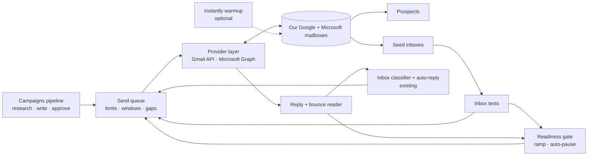

# Own sending engine — plan (2026-10-24)

Status: PLAN ONLY. Nothing built. Decisions in §17 needed from the user first.

## 1. Goal
Send emails, read replies and measure deliverability ourselves, from Google Workspace and
Microsoft 365 mailboxes we own. Instantly becomes optional (warmup only, during a test) and can
then be cancelled.

Rules:
- NOT building: our own mail servers, our own warmup network, cold email through Resend / SES.
- Measure where real emails land (inbox tests) instead of trusting warmup scores.
- Warmup is a per-mailbox option; an on/off test decides whether we keep it.
- Built next to the Instantly path with a per-campaign switch. Nothing breaks during the build;
  campaigns move over one at a time.

## 2. What to buy and set up (user)
| Item | Detail | Cost |
|---|---|---|
| 2 new domains | One for Google, one for Microsoft. Never dna.systems. Website forwards to dna.systems | ~$10–15/yr each |
| 2 Google Workspace mailboxes | Business Starter, domain A, a NEW Workspace account | ~$7–8.40 each/mo |
| 2 Microsoft 365 mailboxes | Business Basic, domain B, a NEW Microsoft 365 account | ~$6–7 each/mo |
| Test inboxes (seeds) | 1 Google Workspace + 1 Microsoft 365 mailbox on accounts SEPARATE from the senders (an existing dna.systems mailbox can be one). Optional: 1 personal Gmail, 1 Outlook.com | $0–15/mo |
| Instantly | Only for the warmup test month, then cancel (or skip) | $47 for 1 month |

Railway stays on Hobby: everything goes over HTTPS (Gmail API, Microsoft Graph). Hobby blocks SMTP only.
Mailboxes use real names (the people who answer), a photo, and a signature with company name + address.

## 3. How it fits together


## 4. What replaces each Instantly call
Instantly is reached only through `backend/src/v2/instantly.ts` (~430 lines), used by mailboxes,
inbox, campaigns/sender, campaigns/service, sequences, dashboard (+ 2 helpers in targeting).

| Today (Instantly) | Own engine |
|---|---|
| listAccounts, getAccount, patchAccount (daily limit), pauseAccount / resumeAccount | `mailboxes` table is the source of truth; our queue enforces the limits |
| testVitals (DNS) | our own DNS checks (MX, SPF, DKIM per provider, DMARC) + domain age |
| enableWarmup / disableWarmup, warmupAnalytics | kept only for mailboxes in warmup mode "instantly"; shown, never required |
| createCampaign, patchCampaign, activate / pause, addLeads | send queue (`outbox`) |
| listCampaignLeads, campaignAnalytics, campaignDailyAnalytics, campaignStepAnalytics, dailyAccountAnalytics | SQL over `outbox` + `messages` |
| listEmails, getEmail (Unibox) | reply + bounce reader |
| replyToEmail | provider send, in the same thread |
| updateInterest, markThreadRead, unreadCount | local only (already stored) |
| blockEntry | our suppression list (already exists) |
| timezoneForCountry, workDaysForCountry | moved unchanged to `v2/schedule.ts` |

## 5. Connecting mailboxes
- "Add mailbox → Sign in with Google / Microsoft". Each mailbox signs in once; we keep a refresh
  token, encrypted at rest (AES-GCM, key from an `APP_SECRET` env var on Railway).
- Google: our own OAuth app in the new Workspace account's Google Cloud project, type **Internal**
  (no Google review, tokens don't expire weekly). Scopes: gmail.send, gmail.modify.
  Not a service account: new Google Cloud orgs block service-account keys by default, and a
  domain-wide key can read every mailbox in the account.
- Microsoft: one app registration; the account admin approves it once. Delegated scopes:
  Mail.Send, Mail.ReadWrite, offline_access.
- Callbacks: `/api/v2/oauth/google/callback`, `/api/v2/oauth/microsoft/callback`.
- Domain assistant: the exact DNS records for the provider (MX, SPF, DKIM, DMARC, website forward)
  with copy buttons and a live check.

## 6. Data model
New tables:
- `mail_connections` — provider, account / tenant, OAuth app ids, encrypted secrets, status, last error.
- `outbox` — every email we send: campaign, prospect, mailbox, step, kind (campaign / reply / test),
  to, subject, body, our Message-ID, provider message + thread ids, In-Reply-To, unsubscribe token,
  scheduled_for, status (scheduled / sending / sent / failed / cancelled), attempts, error, sent_at.
  UNIQUE (prospect, step) for campaign mail, so a step can never go out twice.
- `seed_inboxes` — provider, address, access method, encrypted credentials, status.
- `placement_tests` — mailbox, seed, outbox row, Message-ID, sent_at, checked_at,
  result (inbox / spam / promotions / missing / pending), folder.

Changed (idempotent column adds):
- `mailboxes` + provider, connection_id, auth_status, read_cursor (Gmail historyId / Graph delta link),
  warmup_mode (off / instantly), domain_registered_at, experiment_group.
- `mailbox_health` + placement_sent, placement_inbox, placement_spam, placement_missing, unsubscribes.
- `threads` / `messages` + mailbox_id, provider_thread_id, provider_message_id, message_id_header
  (Instantly ids kept for history).
- `campaigns` + engine (instantly / own).

## 7. Send queue rules
Worker every 30 s, one tick at a time (lock like the campaigns worker).
- Mailbox per lead: step 1 goes from the sendable mailbox with the most room left today, preferring a
  domain not already used for that company. Every follow-up and reply uses that same mailbox.
- Sends only inside the campaign's window, in the lead's timezone and work days (Gulf: Sun–Thu),
  using the existing helpers.
- Per mailbox: under today's limit (ramp); random 6–14 min gap; at least 1 min between mailboxes on
  the same domain; first send of the day at a random time in the first hour of the window.
- Right before each send, check again: the lead hasn't replied, unsubscribed or bounced; nobody at
  the same company domain replied (stop, default on); not suppressed; campaign running; sequence
  version still valid (`isStale`); mailbox still sendable.
- Follow-ups: the next step is created only after the previous one went out, at sent_at + delay days,
  then the next open window. Same thread: "Re: <first subject>", In-Reply-To + References, Gmail threadId.
- Paused mailbox: its leads' follow-ups wait (never switch sender mid-thread); after 7 days paused the
  remaining steps are cancelled with a reason.
- Message: plain text, UTF-8 (Arabic subjects RFC 2047-encoded), Message-ID on our sending domain,
  List-Unsubscribe + List-Unsubscribe-Post (one-click) → `/api/u/<token>`. No open / click tracking.
  Microsoft: sent as MIME, because Graph's JSON format only allows x- headers.
- No double sends: row set to "sending" before the API call; a row stuck in "sending" is looked up in
  the mailbox's Sent folder by Message-ID before any retry.
- Errors: 429 / 5xx retry with backoff (3 tries); auth revoked → mailbox paused "sign in again";
  provider sending block (Gmail daily limit, Microsoft restricted sender) → mailbox paused at once,
  event + banner.

## 8. Reading replies and bounces
- Every 2 min per mailbox: Gmail history since the saved historyId (last 2 days if it expired);
  Graph delta on Inbox and Junk.
- Bounce (mailer-daemon / postmaster, delivery report): failed address + code. 5.x.x = hard → prospect
  bounced, suppressed, steps cancelled. 4.x.x = soft → retry once the next day.
- Reply: matched by In-Reply-To / References → our Message-ID; else provider thread id; else sender
  address against our sends of the last 30 days. Matched replies go into the existing `storeEmail()`
  → classifier → auto-reply. The Inbox screen does not change.
- Unmatched mail (newsletters, warmup mail, spam) is ignored.
- Replies sent by hand from Gmail / Outlook in a known thread are picked up from Sent ("you").
- Agent replies go out through the provider, same thread, same mailbox.

## 9. Inbox tests
- Each mailbox (warming or sending) sends 1 email a day to each seed at a random business-hours
  time. Content: the campaign's real first email written for a sample prospect. Counts toward the
  daily limit.
- Found by Message-ID (Gmail `rfc822msgid:`, Graph internetMessageId, IMAP header search). Checked at
  10 min, 30 min, 2 h. Result: inbox / spam / promotions tab / missing (missing after 2 h = blocked or
  quarantined; counts as spam).
- Seeds never open, reply or move mail — no fake engagement, so the test stays honest. Test mail is
  deleted after 7 days.
- Score per mailbox: last 3 days; business seeds (Workspace, Microsoft 365) count double.
- Domain view: every mailbox on a domain failing = a domain problem (DNS, reputation).

## 10. Readiness gate, ramp, auto-pause
Checks (replace the warmup checks in `mailboxes/policy.ts`):
1. Connected — can send and read.
2. DNS — MX, SPF (includes the provider), DKIM signing on, DMARC.
3. Domain at least 14 days old (RDAP lookup; fallback: date added).
4. Mailbox at least 7 days old (0 for bought pre-warmed mailboxes).
5. Inbox tests: ≥ 12 in the last 3 days, ≥ 75% inbox, and the Microsoft 365 seed in the inbox in at
   least 2 of the last 3.
6. Warmup — only shown for warmup mode "instantly"; never required.

Ramp: 5 a day, +2 a day, up to 30 (editable in Rules). Auto-start unless held (as today).

Auto-pause (sticky; Resume re-gates and restarts the ramp, as today):
- inbox tests under 50% two days running, or the Microsoft 365 seed spam / missing 3 times in a row
- hard bounces > 3% after ≥ 50 sends since the ramp started (existing rule)
- unsubscribes + complaint / legal replies > 1% after ≥ 100 sends
- auth revoked or a sending block from the provider (immediate)

Warning only: reply rate this week under half of last week.

## 11. Warmup option and the test
- `warmup_mode` per mailbox: off / instantly. The Instantly client shrinks to: list accounts, warmup
  on/off, warmup stats for display. Mailboxes of own-engine campaigns are never added to Instantly campaigns.
- Test: 4 mailboxes — Google A (warmup on), Google B (off), Microsoft A (on), Microsoft B (off).
  Same ramp, same campaign, same copy, leads alternated between them.
- 3 weeks. Compare inbox tests (per seed), reply rate, bounce rate.
- Rule: unless the warmup pair is ≥ 10 points better on inbox tests, or clearly better on replies,
  warmup goes off everywhere and Instantly is cancelled.
- 2 vs 2 gives a strong hint, not proof.

## 12. Screens
- Agent → Connections: "Mail accounts" (Google, Microsoft: app setup steps + status), "Test inboxes";
  the Instantly card becomes "Warmup (optional)".
- Mailboxes: Add mailbox (sign in, sender name, signature, warmup mode); DNS assistant per domain;
  inbox-test grid (mailbox × seed × last 7 days) instead of the warmup sparkline; new checks;
  test-group badge; warmup on / off comparison panel.
- Campaigns: engine switch (Instantly / Own) per campaign; "Sending today" timeline per mailbox;
  the lead drawer shows each step: scheduled, sent, from which mailbox.
- Inbox: unchanged.
- Dashboard: same tiles, fed from our own tables.

## 13. Build phases
```plan
0. Spike — prove the risky parts on real accounts
   - Google OAuth (Internal app): send MIME with List-Unsubscribe, read history, find by rfc822msgid
   - Microsoft OAuth: MIME send keeps List-Unsubscribe, immutable IDs, delta on Inbox + Junk
   - Threads look right on both sides; Arabic subject + body encoding
   - From Railway Hobby: Gmail API + Graph work; IMAP to Gmail (only if the Gmail seed is used)
1. Connections + mailboxes
   - mail_connections, encrypted tokens, OAuth flows, provider layer (google.ts, microsoft.ts, mime.ts)
   - Add mailbox, connection test, DNS assistant, domain age
2. Inbox tests
   - seed_inboxes, placement_tests, test sender + checker worker, results grid
   - Runs before any campaign email, so the gate has data from day 1
3. Gate, ramp, auto-pause
   - New checks + rules in policy.ts, warmup optional, Instantly warmup-only mode
4. Send queue
   - outbox, scheduler, mailbox assignment, re-checks, threading, unsubscribe header + /api/u, errors
   - Per-campaign engine switch
5. Reply + bounce reader
   - Gmail history / Graph delta, bounce parsing, reply matching -> existing Inbox flow
   - Agent replies through the provider; replies sent by hand picked up from Sent
6. Stats from our own data
   - Sequence step stats, dashboard daily, campaign stats, mailbox health
7. Warmup test view + switch-over
   - Comparison panel, move campaigns, Instantly off
```
Every phase: a test suite with fake Gmail + Graph servers and a fake clock (3 weeks of ramp in
seconds), both tsc, vite build, version, then push.
Key tests: no double send after a crash; a reply between scheduling and sending stops the step; a
colleague's reply stops the company; sending windows in Asia/Riyadh Sun–Thu; hard vs soft bounce;
auth revoked pauses; Microsoft quarantine counts as missing; Arabic encoding; Instantly campaigns untouched.

## 14. Rollout
1. Buy the domains, set DNS, create the 2 accounts, 4 mailboxes and the seeds.
2. Phases 0–2 live → inbox tests start (no campaign mail yet). Warmup on for 2 mailboxes.
3. Domains age (14 days) while phases 3–5 are built; inbox tests build history.
4. Gate passes → one campaign switched to Own, ramp starts at 5 a day.
5. 3 weeks of sending → compare warmup on / off → decide → move the other campaigns → cancel Instantly.

## 15. Costs (monthly, 4 senders)
| Item | Cost |
|---|---|
| 2 Workspace + 2 Microsoft 365 senders | ~$26–31 |
| Seeds | $0–15 (less if an existing dna.systems mailbox is one) |
| Domains | ~$2 |
| Instantly | $47 during the test month only |
| Railway | unchanged (Hobby) |
| Total after the test | ~$30–50 |

## 16. Risks
- Google / Microsoft may close an account for cold email (same risk as resold mailboxes today)
  → low volume, real people, clean lists, 2 separate accounts, a spare domain aging.
- No vendor support: we are on call → events, banners, auto-pause before damage.
- A bug that double-sends or ignores a reply hurts reputation → UNIQUE (prospect, step), re-checks
  before every send, tests, one campaign first.
- Microsoft quarantine hides mail → missing counts as spam.
- Seeds are not real prospects → combined with reply and bounce rates.
- Tokens can read the mailboxes → only outreach mailboxes in those accounts, encrypted at rest,
  revocable per mailbox.
- Compliance: unsubscribe header honored at once across campaigns (suppression exists), sender name
  + company address in the signature.

## 17. Decisions needed
1. Google, Microsoft, or both? (recommended: both, one domain each)
2. The 2 domain names.
3. Who sends (names on the mailboxes)?
4. Seeds: is dna.systems on Google or Microsoft (to reuse a mailbox)? Add a personal Gmail / Outlook.com?
5. Warmup test with Instantly for a month, or warmup off everywhere from the start?
6. Ramp 5 → +2 a day → 30: OK?
